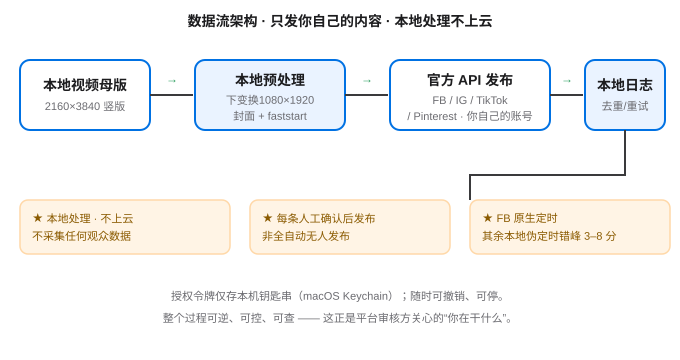

# 架构与数据流 · 给平台审核看

## 一图看懂（architecture_diagram.svg）



## 数据流向（文字版）

```
本地视频母版 (2160×3840 竖版)
        │
        ▼
本地预处理（下变换 1080×1920 · 生成封面 · 封装优化 faststart）
        │
        ▼
通过各平台官方 API 发布 → 仅发布到【你自己的】账号
        │
        ▼
本地发布日志（去重 hash · 指数退避重试 · 账号冻结断路器）
```

## 三个审核方最关心的点

1. **本地处理，不上云**：视频从头到尾只在创作者自己的电脑上处理，不上传到任何第三方服务器。
2. **只发你自己的内容**：工具只允许把视频发到“授权账号 = 发布账号”的本人账号，不碰其他账号、不代发第三方。
3. **逐条人工确认**：不是全自动无人发布。每一条都由创作者本人确认后才发出。

## 用户操作流（User Flow）

```
dry-run（模拟运行，不发真视频）
   │
   ▼
选定要发布的视频 + 填标题/描述
   │
   ▼
创作者人工确认
   │
   ▼
调用官方 API 上传 → 发布
   │
   ▼
写入 published_log 留痕（含帖子 ID，可追溯）
```

## 定时策略

- **Facebook Pages API**：唯一支持服务端原生定时（`scheduled_publish_time`），视频帖 30 天 / Reels 29 天窗口。
- **IG / TikTok / Pinterest**：平台无原生定时，由本地调度器“伪定时”——在设定时间窗内错峰发布（3–8 分钟抖动），避免瞬时群发被风控。

## OAuth 授权流程（用于 2.5 截图素材）

- 工具备份现有令牌 → 删除令牌强制重新授权 → 弹出平台官方授权页 → 创作者点“同意” → 拿回新令牌并存入本机钥匙串。
- 这一步证明“授权可逆、可控”，也是审核方认可的合规动作。
